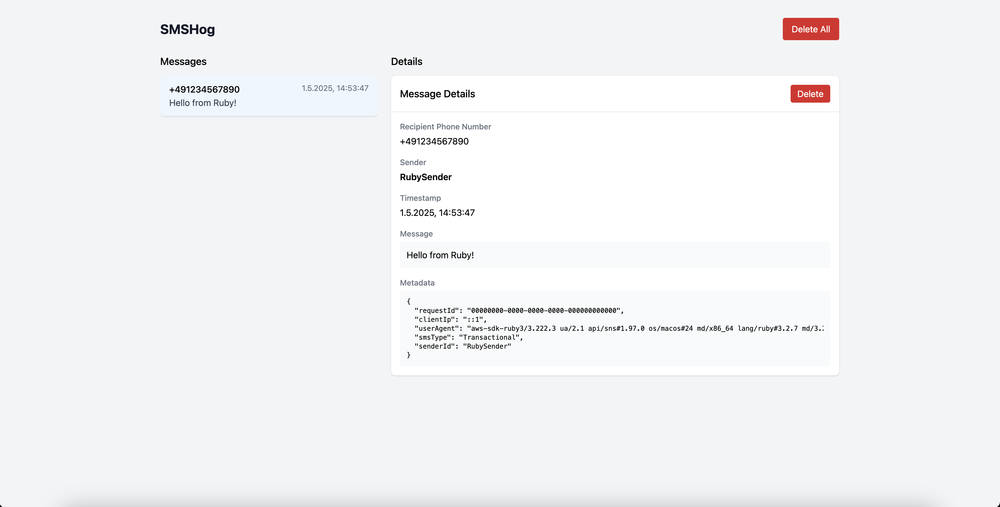

# SMSHog: AWS SNS SMS Mock and Display Tool

SMSHog mocks the AWS SNS SMS API, allowing clients (using aws-sdk v3) to send SMS via the SNS Publish route to SMSHog. The mock API stores these SMS messages and displays them through a MailHog-like web interface.



## Features

- Mock AWS SNS SMS API with support for the Publish and SetSMSAttributes actions
- Capture and display SMS messages with sender ID information
- Web UI to view and manage received messages
- Delete individual or all SMS messages
- Docker support for easy setup and deployment

## Motivation

While developing and testing applications that send SMS using **AWS SNS SMS**, we identified a need for a straightforward tool to simulate message sending, store messages, and display them in a user-friendly interface—much like how MailHog functions for emails. Existing solutions were either overly complex, not specifically tailored to **AWS SNS SMS**, or lacked a web interface to **view** received SMS messages. To bridge this gap, we developed **SMSHog**: a lightweight tool that can be easily run with Docker, providing a realistic local testing environment for sending SMS via **AWS SNS SMS**. This tool simplifies integration and debugging processes without the need to send actual messages or incur additional costs.

## Getting Started

### Prerequisites

- Docker installed

### Running SMSHog

#### Docker run

To run SMSHog using Docker, you can use the following command:

```bash
docker run -p 8080:80 zauberware/smshog
```

This command will:

- Pull the latest SMSHog image from Docker Hub
- Map port 80 of the container to port 8080 on your host machine
- Start the SMSHog server
- Access the web UI at http://localhost:8080

#### Docker Compose

Alternatively, you can use Docker Compose for a more flexible setup. This is especially useful if you want to run SMSHog with additional services or configurations.

1. Clone this repository:

```bash
git clone git@github.com:zauberware/smshog.git
cd smshog
```

2. Copy the `.env.sample` file to `.env` and adjust the settings as needed.

```bash
cp .env.sample .env
```

3. Start the application:

```bash
docker compose up --build
```

4. Access the web UI at http://localhost:8080

#### Development Mode

For development with hot-reloading:

```bash
docker compose -f docker-compose.dev.yml up --build
```

The frontend is then served on `FRONTEND_PORT` and the backend on `BACKEND_PORT` (see `.env`).

To work without Docker:

```bash
yarn install
yarn build   # compile backend and frontend
yarn test    # run the backend tests
```

### Security

SMSHog is a development tool. It has no authentication, allows requests from any origin and lets anyone who can reach it read and delete the captured messages. Run it on your machine or inside a private network only, and do not expose it to the internet.

### Building the image

The image builds for `linux/amd64` and `linux/arm64`:

```bash
docker buildx build --platform linux/amd64,linux/arm64 -t zauberware/smshog:<version> .
```

Add `--push` to publish it. Building both platforms needs a Docker setup with the containerd image store or a `docker-container` buildx builder.

## Using with AWS SDK

Example of how to use SMSHog with the AWS SDK v3:

```javascript
import {
  SNSClient,
  PublishCommand,
  SetSMSAttributesCommand,
} from '@aws-sdk/client-sns';

// Configure the SNS client to use the local SMSHog server
const snsClient = new SNSClient({
  region: 'us-east-1',
  endpoint: 'http://localhost:8080', // SMSHog endpoint
  credentials: {
    accessKeyId: 'dummy-access-key',
    secretAccessKey: 'dummy-secret-key',
  },
});

// Send an SMS
async function sendSMS() {
  const params = {
    Message: 'Hello from Javascript!',
    PhoneNumber: '+491234567890', // Replace with the recipient's phone number
  };

  try {
    await snsClient.send(
      new SetSMSAttributesCommand({
        attributes: {
          DefaultSenderID: 'MySenderId',
          DefaultSMSType: 'Transactional',
          UsageReportS3Bucket: 'my-s3-bucket',
        },
      })
    );
    const data = await snsClient.send(new PublishCommand(params));
    console.log('Success! Message ID:', data.MessageId);
  } catch (err) {
    console.error('Error sending message:', err);
  }
}

sendSMS();
```

further example usage can be found in the [examples](./examples) directory.

## API Endpoints

### SNS Mock API

- `POST /` or `POST /sms` - Handle SNS requests (`Publish` and `SetSMSAttributes`)

`Publish` only supports sending to a `PhoneNumber`. Requests that target a `TopicArn` or `TargetArn` are answered with `InvalidParameter`.

The message attributes `AWS.SNS.SMS.SenderID` and `AWS.SNS.SMS.SMSType` override the defaults set through `SetSMSAttributes` for a single message.

### REST API

- `GET /api/v1/health` - Check the health of the server
- `GET /api/v1/sms` - Get all SMS messages
- `GET /api/v1/sms/:id` - Get a specific SMS message
- `DELETE /api/v1/sms/:id` - Delete a specific SMS message
- `DELETE /api/v1/sms` - Delete all SMS messages

## Architecture

SMSHog consists of two main components:

1. **Backend**: Node.js/Express server with TypeScript that implements the AWS SNS mock API
2. **Frontend**: React with TypeScript and Vite for displaying and managing SMS messages

## Data Persistence

By default, SMSHog stores all messages in memory, which means they'll be lost when the server restarts.  
To enable data persistence, set the following environment variables:

```bash
# Enable persistence
SMSHOG_PERSIST=true

# Optional: Specify a custom path for the data file (default: /data/sms-store.json)
SMSHOG_PERSIST_PATH=/path/to/your/data/file.json
```

If the data file cannot be read on startup, it is kept next to the original as `<file>.corrupt-<timestamp>` and SMSHog starts with an empty list.

When using Docker, you can enable persistence by:

```bash
docker run -p 8080:80 -e SMSHOG_PERSIST=true -v $(pwd)/data:/data zauberware/smshog
```

## Environment Variables

| Variable            | Description                           | Default Value        |
| ------------------- | ------------------------------------- | -------------------- |
| SMSHOG_PERSIST      | Enable data persistence (true/false)  | false                |
| SMSHOG_PERSIST_PATH | Path to the data file for persistence | /data/sms-store.json |
| SMSHOG_MAX_MESSAGES | Keep only the newest N messages       | unlimited            |

## License

MIT
